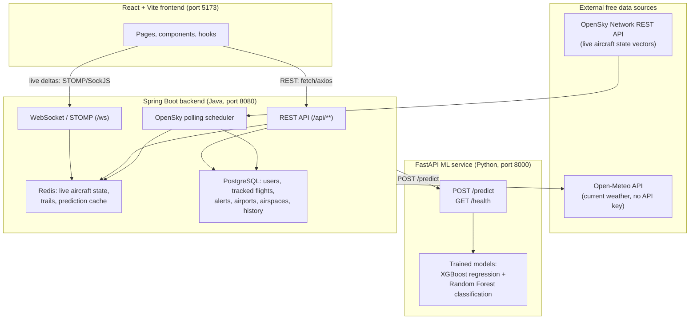

# AeroAI — Final Project Reference

This document explains **exactly what every part of the AeroAI project does, how it
works, and how to run it**, down to the file level. It is written so that someone
with no prior context can read it and fully understand the system.

For the authoritative product/UX specification, see `IMPLEMENT_v2.md`. For the exact
backend↔frontend wire contract, see `BACKEND_FRONTEND_HANDOFF.md`. For backend
completion status, see `BACKEND_IMPLEMENTATION_STATUS.md`. This document is a plain-
English walkthrough that ties all three together with the actual code.

---

## 1. What AeroAI is

AeroAI is an **AI-based air traffic monitoring and prediction system**. It shows real,
live aircraft positions (sourced from OpenSky Network) over a chosen city/airspace on
an interactive map, lets users search and inspect individual flights and airports,
predicts flight arrival delays using two trained machine-learning models, calculates
mid-air conflict-risk between nearby aircraft using real geometry (not ML), and lets
registered users track specific flights and receive alerts when something meaningful
changes.

The guiding rule across the entire codebase (see `IMPLEMENT_v2.md` §3.1) is:
**never fabricate data**. If the backend doesn't have a real value for something
(e.g. an aircraft's destination airport, because OpenSky doesn't provide flight-plan
data), the UI renders the literal word **"Unavailable"** instead of guessing, showing
`0`, or hiding the field.

---

## 2. High-level architecture



Three independent services run side by side:

1. **PostgreSQL + Redis** — plain data infrastructure (via Docker Compose).
2. **ML service** (`ml/`) — a small, single-purpose FastAPI app that only does one
   thing: take flight/schedule/weather features in, return a delay prediction out.
   It knows nothing about OpenSky, the database, users, or WebSockets.
3. **Backend** (`backend/`) — a Spring Boot application that is the **only** thing
   the frontend ever talks to. It ingests live aircraft data from OpenSky, computes
   flight status/distance/conflict-risk, calls the ML service for delay predictions,
   manages users/auth/tracking/alerts, and exposes it all as one clean REST + WebSocket
   API.
4. **Frontend** (`frontend/`) — a React single-page app that renders everything above.
   It never talks to OpenSky, Open-Meteo, or the ML service directly — only to the
   Spring Boot backend, per `IMPLEMENT_v2.md` Rule 4.

---

## 3. The backend (`backend/`) — what it does

The backend is a Maven/Spring Boot project. Source lives under
`backend/src/main/java/com/aeroai/backend/`, organized **by feature**, not by layer
(each feature package typically has its own controller, service, entity/repository,
and a `dto/` sub-package for its API request/response shapes):

| Package | Responsibility |
|---|---|
| `auth/` | Register, login, logout. Issues JWTs (HS512, 60-minute expiry). Passwords hashed with BCrypt. |
| `common/` | Shared plumbing: the error envelope (`ApiError`), global exception handler, generic paging/response helpers, small utilities (e.g. haversine distance math). |
| `config/` | Spring configuration: security filter chain, CORS, WebSocket/STOMP registration, scheduling, RestTemplate/WebClient beans for calling OpenSky/Open-Meteo/FastAPI. |
| `airspace/` | The "city catalogue" — 60 seeded major cities (25 Indian + 35 international), each with a bounding box, default map zoom, and (on the detail endpoint) nearby real airports. Backs the city/airspace selector. |
| `airport/` | The airport directory (seeded real airports) — search, pagination, single-airport lookup. |
| `opensky/` | Talks to the OpenSky Network REST API on a schedule (default every 15s), normalizes raw state vectors into `AircraftDto`-shaped records, and writes them into Redis. Bounded to a configurable number of "active" city airspaces at once so the free OpenSky rate limit is never exceeded. |
| `flight/` | The core "flights" feature: current aircraft snapshot (`/api/flights/current`), the flights table (`/api/flights`), search (`/api/flights/search`), and full flight detail (`/api/flights/{icao24}`, including weather + prediction + conflicts). Also derives flight **status** (Scheduled/In Flight/Landed/Unknown) and distance-travelled math from trail history. |
| `weather/` | Calls Open-Meteo for current conditions at a given lat/lon, with an in-memory/Redis cache (≈10–15 min TTL) so many concurrent users don't multiply external calls. Embedded into flight detail responses — there is no standalone weather endpoint. |
| `prediction/` | Builds the exact feature payload the ML service expects, calls `POST /predict` on the FastAPI service, caches the result in Redis (`PREDICTION_CACHE_TTL_SECONDS`, default 900s), and maps the response into `PredictionDto`. |
| `conflict/` | Real-time conflict-risk detection: for aircraft close to each other, computes closing speed, DCPA (distance at closest point of approach), TCPA (time to closest point of approach), and buckets the result into `MEDIUM`/`HIGH` (or nothing, meaning implicit `LOW`). Pure math, not ML. |
| `tracking/` | Lets an authenticated user track/untrack a specific aircraft (`/api/tracked-flights`), and lists "my flights" (`/api/me/flights`). |
| `alert/` | Generates and stores per-user alerts when a tracked flight's status, delay category, or conflict-risk level changes meaningfully (with de-duplication so identical alerts don't spam). Exposes `/api/alerts`, unread count, mark-as-read. |
| `analytics/` | Aggregates live traffic counts, flight stats, conflict stats, and system health (OpenSky/Open-Meteo/ML up-or-degraded status + data freshness) into one `/api/analytics` response. |
| `websocket/` | The STOMP/SockJS endpoint at `/ws`. Broadcasts `added`/`updated`/`removed` aircraft deltas per city topic (`/topic/aircraft/{cityId}`) whenever the OpenSky polling cycle detects a real change — it does **not** broadcast empty no-op messages. |
| `maintenance/` | Scheduled cleanup jobs (e.g. trimming old trail points, enforcing history retention). |

**Persistence model** (§20–22 of `IMPLEMENT_v2.md`):
- **Redis** holds anything that's inherently short-lived/live: the current state of
  each aircraft (TTL ~90s, so an aircraft that stops reporting naturally "disappears"
  without a manual delete), per-aircraft trail points (a sorted set trimmed to the
  last hour), and cached ML predictions.
- **PostgreSQL** holds anything that must survive restarts and belongs to a user:
  accounts, tracked-flight relationships, alerts, the airport/airspace reference
  data, and retained flight history (default 7 days) used for things like arrivals/
  departures counts in Analytics.

**Known, documented data limitations** (not bugs — see `BACKEND_FRONTEND_HANDOFF.md`):
OpenSky's live state vectors carry **no** flight-plan information — no origin,
destination, scheduled times, or aircraft-type field. So `origin`/`destination` are
always `null` today, live arrivals/departures tables are not exposed, and
`distanceRemainingKm`/`estimatedArrival` are always `null` (they depend on a known
destination). The frontend renders all of this honestly as "Unavailable" instead of
inventing it.

---

## 4. The ML service (`ml/`) — what it does

A minimal FastAPI app (`ml/api/main.py`) whose only job is delay prediction:

- **`GET /health`** → `{"status": "ok", "models_loaded": true}` — used by the backend
  for its own health/circuit-breaker logic.
- **`POST /predict`** → accepts the exact JSON shape defined in `IMPLEMENT_v2.md` §33
  (route, airline, distance, scheduled date/time, optional weather fields, etc.),
  derives time-based features internally (day of week, cyclical hour encodings,
  departure period bucket, etc.), and runs two pre-trained models loaded from
  `ml/models/`:
  - `final_delay_regression_model.pkl` — **XGBoost** regression → predicted delay in
    minutes (clamped to ≥ 0).
  - `final_delay_classification_model.pkl` + `classification_threshold.pkl` —
    **Random Forest** classification → probability that the delay exceeds 15 minutes,
    thresholded at 0.45.
  - A `category` (`Low` / `Moderate` / `High`) is derived deterministically from the
    regression output's minute bands (0–15 / 16–45 / 46+) — no third model.

This service is intentionally **ML-only**: it has no knowledge of OpenSky, Postgres,
Redis, authentication, or WebSockets. The Spring Boot backend is the only caller, and
it caches results so the ML service is not hammered on every 15-second position
update (predictions and live position are completely separate update loops).

---

## 5. The frontend (`frontend/`) — what it does and how it's organized

The frontend is a **React 18 + TypeScript + Vite** single-page app. It talks
**exclusively** to the Spring Boot backend (`http://localhost:8080/api/**` for REST,
`http://localhost:8080/ws` for STOMP/WebSocket) — never directly to OpenSky,
Open-Meteo, or the ML service.

### 5.1 Folder-by-folder explanation

```text
frontend/src/
├── main.tsx              Entry point: mounts <App/> inside BrowserRouter + QueryProvider
├── App.tsx               All route definitions (React Router v6)
├── vite-env.d.ts         TypeScript types for Vite's import.meta.env.* variables
│
├── api/
│   └── client.ts         The ONE axios instance every request goes through.
│                         - Base URL from VITE_API_BASE_URL (+ "/api")
│                         - Request interceptor: attaches "Authorization: Bearer <jwt>"
│                           from localStorage on every call
│                         - Response interceptor: on 401, clears the stored token and
│                           redirects to /login?returnTo=<current path>
│                         - extractErrorMessage()/extractErrorCode(): read the backend's
│                           standard { timestamp, status, error, message, path } envelope
│
├── services/             One thin file per backend "feature area". Every function is a
│   ├── authService.ts      1:1 wrapper around a single REST endpoint. Components/hooks
│   ├── flightsService.ts   NEVER call axios directly — only these files do, and only
│   ├── airportsService.ts  these files know REST paths/params. This is the sole
│   ├── airspacesService.ts boundary between "how we talk to the backend" and
│   ├── trackingService.ts  "what the UI does with the data".
│   ├── alertsService.ts
│   └── analyticsService.ts
│
├── types/index.ts        Every TypeScript interface mirrors a backend DTO byte-for-byte
│                         (field names, nullability, enum values) as documented in
│                         BACKEND_FRONTEND_HANDOFF.md. Nothing here is invented, and
│                         nothing here computes/derives a value — nested types like
│                         AircraftDto, FlightDetailDto, ConflictRiskDto, AnalyticsDto,
│                         AircraftDeltaMessage (the WebSocket payload) all live here.
│
├── store/
│   └── authStore.ts       A tiny Zustand store: { token, user, isAuthenticated }.
│                         Persists token+user to localStorage; setAuth()/clearAuth()
│                         are the only mutation points, called from Login/Register
│                         pages and the 401 interceptor / logout flow.
│
├── hooks/
│   ├── useWebSocket.ts    Low-level STOMP/SockJS connection manager (see §6 below).
│   ├── useLiveAircraft.ts Combines the initial REST snapshot with WebSocket deltas
│                         into one Map<icao24, AircraftDto>, keyed by the stable
│                         ICAO24 identifier (never by array index).
│   ├── useAirspaces.ts    React Query wrappers: full city list (optionally filtered)
│                         and single-city detail (bounds + nearby airports).
│   └── useAlerts.ts       React Query wrappers for the alerts feature: unread-count
│                         polling (every 30s), alert list, mark-read/mark-all-read
│                         mutations, and a Web Notifications API integration that
│                         fires a real browser notification for newly-seen alerts.
│
├── utils/
│   ├── formatters.ts      ALL display formatting lives here: unit conversions
│                         (m/s→km/h, meters→feet), "Unavailable" fallbacks, relative
│                         "Xs ago" time text, the LIVE/DELAYED/UNAVAILABLE freshness
│                         calculation. Nothing here re-derives a value the backend
│                         already computed (ETA, distance, conflict risk, status) —
│                         see IMPLEMENT_v2.md §AH for why that distinction matters.
│   └── config.ts          Small tunable constants mirrored from IMPLEMENT_v2.md §94:
│                         map tile URL, default map center/zoom, default city id,
│                         freshness thresholds, callsign-label zoom bands.
│
├── app/
│   ├── QueryProvider.tsx  Wraps the app in a single shared TanStack React Query client
│                         (30s default staleTime, no refetch-on-window-focus).
│   └── ProtectedRoute.tsx Redirects to /login?returnTo=... if the user isn't
│                         authenticated; wraps /my-flights and /account in App.tsx.
│
├── components/
│   ├── common/            Cross-cutting, reusable, presentation-only building blocks:
│   │     Badge.tsx           StatusBadge, RiskBadge, CategoryBadge, AiBadge, CalcBadge
│   │     UnavailableText.tsx literal "Unavailable" renderer (§3.1 rule, one place)
│   │     LoadingSpinner.tsx, ErrorState.tsx, EmptyState.tsx
│   │     LiveIndicator.tsx   the ticking LIVE / DATA DELAYED / LIVE DATA UNAVAILABLE badge
│   │     GlobalSearch.tsx    header search box — queries flights+airports+airspaces
│   ├── layout/             App shell chrome: Header, BottomNav (mobile), AccountMenu,
│   │                       Logo (inline SVG radar/aircraft mark), AppLayout (the
│   │                       Header + <Outlet/> + BottomNav wrapper every route renders inside)
│   ├── map/                Everything Leaflet-specific:
│   │     LeafletMap.tsx      the actual <MapContainer> + aircraft/airport markers + trail line
│   │     aircraftIcon.ts     builds rotatable plane-silhouette DivIcons (heading-based
│   │                         rotation, color by selection/conflict state, zoom-banded
│   │                         callsign label)
│   │     AirspaceSelector.tsx searchable city-picker modal (backed by useAirspaceList)
│   │     MapFilters.tsx      status / airline / tracked-only filter panel
│   │     MapControls.tsx     zoom+/-, reset, fullscreen, locate-me, filter toggle
│   ├── flights/            FlightDetailPanel.tsx (the single shared "flight detail"
│   │                       component rendered both as the Map's side panel/bottom
│   │                       sheet AND as the standalone /flights/{icao24} page body),
│   │                       FlightTable.tsx, TrackButton.tsx, TrailMiniMap.tsx
│   ├── airports/, analytics/, alerts/  smaller feature-specific pieces (KpiCard,
│   │                       NotificationBell, etc.)
│
├── pages/                 One folder per route (see §5.2). Pages compose the
│   ...                    components above with React Query data-fetching; pages
│                          themselves contain no direct axios calls and no derived-math.
│
└── styles/index.css       Tailwind entry point + the pinned dark/cyan design tokens,
                          shared utility classes (.panel, .btn-primary, .aero-input,
                          .badge, .avia-num for tabular-figure numbers).
```

### 5.2 Routes (`App.tsx`)

| Route | Page | Auth | What it shows |
|---|---|---|---|
| `/` | `HomePage` | public | Hero + live snapshot strip pulled from `/api/analytics`, feature links |
| `/map` | `MapPage` | public | The full-screen live Leaflet map — the core product experience |
| `/flights` | `FlightsPage` | public | Searchable/filterable/paginated flights table |
| `/flights/:icao24` | `FlightDetailsPage` | public (tracking requires login) | Full flight detail via shared `FlightDetailPanel` |
| `/airports` | `AirportsPage` | public | Searchable/paginated airport directory |
| `/airports/:id` | `AirportDetailsPage` | public | Airport info + "View Live Traffic Around Airport" → `/map` |
| `/analytics` | `AnalyticsPage` | public | KPI cards + charts from `/api/analytics` |
| `/my-flights` | `MyFlightsPage` | **required** | Tracked-flight dashboard |
| `/account` | `AccountPage` | **required** | Email, join date, tracked-flight count, logout |
| `/login`, `/register` | `LoginPage`, `RegisterPage` | public | Email+password auth forms |
| `*` | `NotFoundPage` | public | 404 |

Every route renders inside `AppLayout`, which always shows the `Header` (desktop nav +
search + auth/account/bell) and, on small screens, a fixed `BottomNav` with the five
primary sections one tap away. The Map page is the one exception to normal page
padding — it fills 100% of the space below the header so the map itself dominates the
screen, with its own floating overlay controls (top-left = airspace selector +
filters, top-right = live indicator + zoom/reset/fullscreen/locate controls, right
side/bottom-sheet = flight detail panel).

### 5.3 How data flows through the frontend, end to end

**Example: opening `/map` and clicking an aircraft.**

1. `MapPage` reads the selected city from the URL (`?airspace=mumbai`, defaulting to
   `mumbai` if absent) and calls `useAirspaceDetail(cityId)`, which hits
   `GET /api/airspaces/{cityId}` via `airspacesService` → gives back the city's center,
   zoom, bounding box, and nearby real airports.
2. `MapPage` also calls `useLiveAircraft(cityId)`, which:
   - Immediately fetches `GET /api/flights/current?airspaceId={cityId}` for the
     initial snapshot of aircraft (`AircraftDto[]`).
   - Opens a STOMP connection (over SockJS) to `/ws` and subscribes to
     `/topic/aircraft/{cityId}`.
   - Every time the backend's OpenSky poll cycle detects a real change, it pushes a
     delta message `{ added, updated, removed }`; the hook merges this into a
     `Map<icao24, AircraftDto>` so markers update in place instead of remounting.
3. `LeafletMap` renders one Leaflet marker per aircraft with a custom rotated
   plane-silhouette icon (rotation = the aircraft's true heading), colored cyan by
   default or highlighted if selected/in a conflict.
4. Clicking a marker sets `selectedIcao24` in `MapPage`'s state, which mounts a
   `FlightDetailPanel` in a side panel (desktop) or bottom sheet (mobile). That panel
   independently fetches `GET /api/flights/{icao24}` (full detail: position, weather,
   AI prediction, conflicts) and, if a trail exists, `GET /api/flights/{icao24}/trail?minutes=15`
   — which it also reports back up to `MapPage` so the main map can draw the trail
   polyline.
5. If the user is logged in and clicks **"＋ Track Flight"**, `TrackButton` calls
   `POST /api/tracked-flights`; if not logged in, it shows an inline
   "Create an account to track flights" prompt with Login/Register buttons instead of
   silently doing nothing.

Every step above only ever goes through a `services/*.ts` file — no component calls
`axios`/`fetch` directly, and no component recomputes something the backend already
calculated (ETA, distance, conflict risk, status, freshness label).

---

## 6. The live map / WebSocket implementation in detail

This is the most architecturally important piece of the frontend, so it's worth
walking through precisely.

**`hooks/useWebSocket.ts`** owns the actual STOMP/SockJS connection lifecycle:

1. On mount (or when `cityId` changes), it first calls
   `flightsService.getCurrent(cityId)` (REST) to get a clean starting snapshot.
2. It then creates a `@stomp/stompjs` `Client` whose transport is `sockjs-client`
   pointed at `VITE_WS_URL` (default `http://localhost:8080/ws`).
3. On `CONNECT`, it subscribes to `/topic/aircraft/{cityId}` and reports
   `connectionState = 'connected'`.
4. Every incoming STOMP message is JSON-parsed into an `AircraftDeltaMessage`
   (`{ timestamp, added, updated, removed }`) and handed to the caller's `onDelta`.
5. If the socket closes, it reports `connectionState = 'disconnected'`, then retries
   with **exponential backoff** (1s → 2s → 4s → … capped at 30s, reset to 1s on the
   next successful connect). On every reconnect attempt it **re-fetches the REST
   snapshot first**, then resubscribes — this closes any gap in missed deltas rather
   than trusting the delta stream alone to "catch up."
6. Unmounting (or switching city) tears the subscription and client down cleanly so
   no stale-city messages leak into a newly selected city.

**`hooks/useLiveAircraft.ts`** is a thin state-management layer on top of that: it
keeps a `Map<icao24, AircraftDto>`, replacing the whole map atomically on a fresh
snapshot (so a city switch never briefly shows a mix of two cities' aircraft), and
applying `added`/`updated` (full-record replace, never a partial-field patch, per the
wire contract) / `removed` (delete by key) on every delta.

**Why SockJS instead of a raw WebSocket:** the backend's `/ws` endpoint is exposed
both as a raw WebSocket upgrade and as a SockJS-wrapped endpoint, specifically so it
still works in network environments that block raw WebSocket upgrades. The frontend
uses the SockJS client for maximum compatibility, at the cost of the browser-runtime
quirk fixed in §7 below.

---

## 7. Bug fix: "Uncaught ReferenceError: global is not defined"

### What was happening

`sockjs-client` (a dependency of the WebSocket setup above) is a package written
against Node.js conventions. One of its internal files,
`sockjs-client/lib/utils/browser-crypto.js`, contains code like:

```js
if (global.crypto && global.crypto.getRandomValues) { ... }
```

`global` is Node.js's global object. It does not exist in a browser — browsers have
`window`/`globalThis` instead. Older bundlers like Webpack silently polyfilled `global`
for you; **Vite does not**, by design (it targets modern browsers/ESM and avoids
unnecessary Node-compat shims). The moment this module executed in the browser
(as soon as any code imported `sockjs-client`, i.e. as soon as the app tried to open
its live-map WebSocket connection), it threw `ReferenceError: global is not defined`,
which — because it happened during module evaluation at the top of the dependency
graph — crashed the entire React render and produced a blank/white page.

### The fix

This is a **frontend-build-configuration-only** fix. Nothing in the backend, the API
contract, application architecture, or `useWebSocket.ts`/`useLiveAircraft.ts` changed.
The fix lives entirely in `frontend/vite.config.ts`:

```ts
export default defineConfig({
  plugins: [react()],
  server: { port: 5173 },
  define: {
    global: 'globalThis',
  },
  optimizeDeps: {
    esbuildOptions: {
      define: {
        global: 'globalThis',
      },
    },
  },
})
```

Two separate settings were required, because Vite has **two independent build
pipelines** that each needed to know about the rewrite:

1. **`define`** — a build-time find/replace applied by Rollup/esbuild when compiling
   the production bundle (`vite build`) and when transforming your own project source.
   This alone fixed `npm run build`.
2. **`optimizeDeps.esbuildOptions.define`** — Vite's **dev server** pre-bundles
   `node_modules` dependencies once, up front, using a *separate* esbuild invocation
   (dependency optimization) that does **not** automatically inherit the top-level
   `define`. Without this second setting, `npm run build` would be fixed but
   `npm run dev` would still throw the exact same error, because the cached
   `node_modules/.vite/deps/sockjs-client.js` file still contained the literal
   `global.crypto` reference.

With both in place, every occurrence of the bare identifier `global` anywhere in the
dependency graph is rewritten to `globalThis` at build time — in both the dev server's
pre-bundled dependencies and the production Rollup bundle. This is a compile-time text
substitution, not a runtime shim/polyfill object, so it has zero runtime overhead and
zero effect on application behavior; `globalThis` is simply the standards-based,
browser-native equivalent of what the code was already trying to reach.

*(A one-line UMD wrapper parameter also happens to be named `global` inside
`@stomp/stompjs`'s bundled output — that is unrelated boilerplate that was never
broken; it's a local function parameter, not a reference to the missing Node global,
and it already has its own `typeof globalThis !== 'undefined'` fallback.)*

### Verification performed

1. **`npm run build`** (`tsc && vite build`) completes with **zero TypeScript errors**
   and a successful production bundle.
2. Inspected the built output (`dist/assets/index-*.js`) directly and confirmed every
   `global.crypto` reference had been rewritten to `globalThis.crypto`.
3. Cleared the Vite dependency cache (`node_modules/.vite`) and started the **dev**
   server, then fetched the pre-bundled dependency file
   (`/node_modules/.vite/deps/sockjs-client.js`) directly and confirmed it also now
   reads `globalThis.crypto` — i.e. the fix applies to `npm run dev`, not just
   `npm run build`.
4. Confirmed the dev server serves `/`, `/src/main.tsx`, and the sockjs dependency
   chunk all with `200 OK`, with no server-side transform errors in the Vite log.

---

## 8. How to run the project

### 8.1 Prerequisites

- **Java 17+** and **Maven** (for the backend)
- **Python 3.10+** (for the ML service)
- **Node.js 18+** and **npm** (for the frontend)
- **Docker** (for PostgreSQL + Redis) — or install/run them natively if you prefer
- An internet connection (OpenSky + Open-Meteo are free, no-signup APIs used live)

### 8.2 Environment variables

Copy the example env files and adjust only if needed (defaults already work for
local development):

```bash
# from the repo root
cp .env.example .env
cp frontend/.env.example frontend/.env
```

The frontend only ever reads three **public** values (never secrets):

```text
VITE_API_BASE_URL=http://localhost:8080
VITE_WS_URL=http://localhost:8080/ws
VITE_MAP_TILE_URL=https://{s}.tile.openstreetmap.org/{z}/{x}/{y}.png
```

### 8.3 Start everything, in order

**Step 1 — infrastructure (PostgreSQL + Redis):**

```bash
# from the repo root
docker compose up -d postgres redis
```

**Step 2 — ML service (FastAPI), in its own terminal:**

```bash
# from the repo root
python -m venv .venv          # first time only
source .venv/bin/activate     # Windows: .venv\Scripts\activate
pip install -r ml/api/requirements.txt
python -m uvicorn ml.api.main:app --reload --port 8000
```

Verify: `curl http://127.0.0.1:8000/health` → `{"status":"ok","models_loaded":true}`

**Step 3 — backend (Spring Boot), in its own terminal:**

```bash
cd backend
mvn spring-boot:run -Dspring-boot.run.profiles=dev
```

Verify: `curl http://localhost:8080/actuator/health` → `{"status":"UP"}`

**Step 4 — frontend (Vite dev server), in its own terminal:**

```bash
cd frontend
npm install       # first time only
npm run dev
```

Open **http://localhost:5173** in your browser. The app should load the AeroAI
homepage; clicking **"Explore Live Traffic"** opens the live map for Mumbai (the
default city) with real aircraft appearing within a few seconds.

### 8.4 Alternative: full container stack (everything except the frontend)

```bash
# from the repo root
docker compose up --build
```

This starts Postgres, Redis, the ML service, and the backend together. Still run the
frontend separately with `npm run dev` (Step 4 above) pointed at
`VITE_API_BASE_URL=http://localhost:8080`.

### 8.5 Building the frontend for production

```bash
cd frontend
npm run build      # runs `tsc` type-checking, then `vite build`
npm run preview    # serves the production build locally for a final check
```

Output goes to `frontend/dist/`.

### 8.6 Quick sanity checklist after starting everything

- [ ] `http://localhost:8080/actuator/health` → `UP`
- [ ] `http://127.0.0.1:8000/health` → `{"status":"ok","models_loaded":true}`
- [ ] `http://localhost:5173/` loads the homepage with no console errors
- [ ] `/map` shows live aircraft moving over Mumbai within ~15–20 seconds
- [ ] Registering an account, tracking a flight, and seeing it on `/my-flights` works
- [ ] `/analytics` shows non-zero "Aircraft visible" once the map has loaded once

---

## 9. Design/behavior rules that shaped every decision (quick reference)

These are the rules from `IMPLEMENT_v2.md` that most influenced the frontend
implementation, summarized for quick recall:

- **Never fabricate data** (§3.1) — every `null`/absent backend field renders the
  literal word "Unavailable", never `0`, `--`, or a guess.
- **AI vs. Calculated badges** (§AI) — ML-generated values (delay prediction) always
  show an **"AI"** badge with the exact disclaimer string the backend provides.
  Backend-computed-but-non-ML values (distance, ETA, conflict geometry) show an
  **"Est."/Calculated** badge instead. Never both on the same value.
  Conflict risk `LOW` is *implicit* (an empty `conflicts[]` array), never a literal
  string — the UI treats "no conflicts returned" as "LOW risk", not "unavailable".
- **One active airspace at a time** (§18.4) — the backend polls OpenSky for one city
  by default (`AIRSPACE_MAX_ACTIVE_CITY_COUNT=1`); switching cities may show an
  empty/stale snapshot for a moment while the backend's scheduler spins up polling for
  the newly selected city. The frontend treats this as normal loading, not an error.
- **Frontend never re-derives backend math** (§AH) — ETA, distance travelled/
  remaining, conflict risk (DCPA/TCPA), and flight status are all computed once, on
  the backend, and rendered as-is. The frontend only does pure display-unit
  conversions (m/s→km/h, meters→feet, UTC→local time).
- **Public vs. authenticated** — viewing (map, flights, airports, analytics) is
  always public. Only tracking a flight, alerts, "My Flights", and "Account" require
  a logged-in session (a JWT in `localStorage`, sent as `Authorization: Bearer <token>`).
